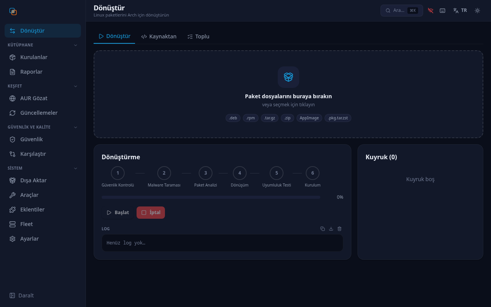
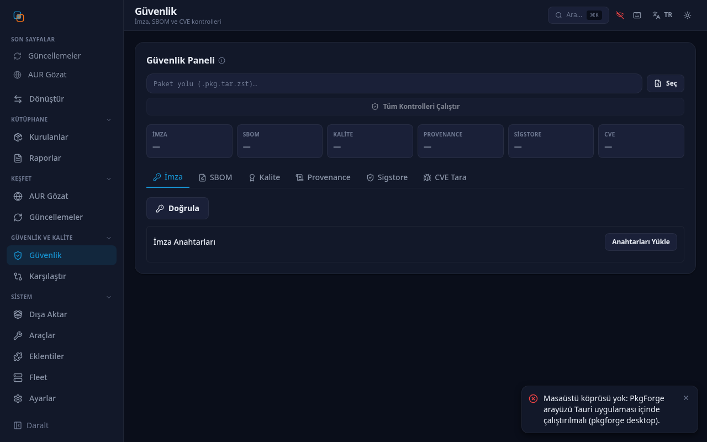
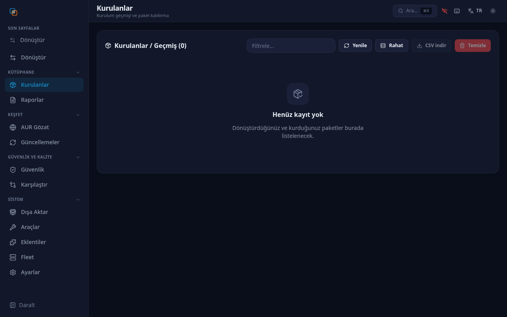
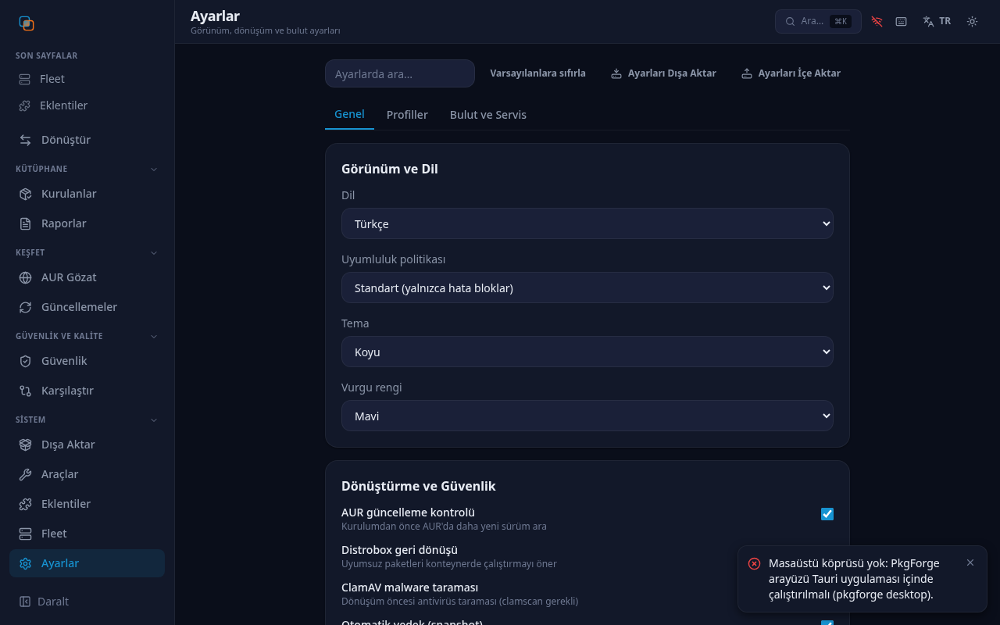

# PkgForge

> **Modern, Sandboxed `.deb` and `.rpm` Package Converter & Lifecycle Manager for Arch Linux & CachyOS**

[](LICENSE)
[](pyproject.toml)
[](#-running-tests)
[](#-running-tests)
[](#-running-tests)
[](#-security-architecture)
[](#-running-tests)
[](#-running-tests)

> Rozet sayıları elle yazılmaz; **aşağıdaki "Current status" bloğundaki** ölçüm
> komutlarından üretilir (`7443 passed` = tam `make verify` koşusu, `594` = vitest test
> bildirimi sayımı). Coverage rozeti CI tarafından güncellenir
> (`.github/workflows/test.yml` "Update Coverage Badge" adımı).

**PkgForge** converts Debian (`.deb`) and RedHat (`.rpm`) packages into Arch Linux compatible `.pkg.tar.zst` packages. It features a **high-speed pure Python native converter**, **Bubblewrap sandbox isolation**, **full Headless CLI**, **Tauri desktop app**, **URL direct downloading**, **package lifecycle management (uninstall & rollback)**, and **upstream update tracking**.

---

## 🧪 Demo (real output)

```console
$ pkgforge convert hello_1.0.0-1_amd64.deb --dry-run
    ==> "hello" paketi oluşturuluyor...
    ==> hello 1.0.0-1 paketinin derlenmesi tamamlandı
✅ Paket başarıyla dönüştürüldü: hello-1.0.0-1-x86_64.pkg.tar.zst
📊 Uyumluluk notu: B (warning)
📁 Kurulacak dosyalar: 2
    ./usr/bin/hello
    ./usr/share/hello/data.txt
📋 Provenance: hello-1.0.0-1-x86_64.pkg.tar.zst.provenance.json
```

---

## 🖥️ Screenshots (Tauri desktop, dark theme)

| Convert | Security |
|---|---|
|  |  |

| Installed | Settings |
|---|---|
|  |  |

> Captured headlessly via `desktop/scripts/visual-tour.py` (12/12 pages
> render-checked). Backend-dependent panels show their empty states here;
> connected screenshots require the Tauri runtime.

---

## 🎯 Key Features

- **⚡ Fast Pure Python Native Converter**: Converts `.deb` packages directly into `PKGBUILD` and `.pkg.tar.zst` in seconds without slow external scripts.
- **🛡️ 12 Security Layers & Bubblewrap Sandbox**: Executes `makepkg` and conversions inside isolated `bwrap` sandboxes with strict MIME, GPG, SHA-256 and Path Traversal checks, plus **optional ClamAV malware scanning** (`clamav` is an `optdepends` entry; the scan is reported as skipped when `clamscan` is not installed).
- **💻 Dual Interface (Headless CLI + Tauri Desktop)**: CLI runs without any GUI dependencies. The primary graphical interface is the Tauri 2 + React desktop app (`desktop/`, build with `cd desktop && pnpm tauri build`). Every graphical intent prefers it: `pkgforge desktop`, `pkgforge --file X.deb`, and the file manager's "Open with" entry all launch the Tauri shell and hand it the package files. The legacy PyQt6 GUI (`pkgforge gui`) is frozen — security fixes only, removal planned for v3.0, and it now points at the modern UI when that is installed.
- **🖥️ Native Tauri Desktop App**: A modern Tauri 2 + React 19 shell (in `desktop/`) with tr/en i18n, theme + accent colors, command palette, feature tour, lazy-loaded pages, and a Python sidecar over JSON-RPC. Build with `cd desktop && pnpm tauri build`.
- **🌐 Direct URL Conversion**: Download and convert packages directly from HTTP/HTTPS links (`pkgforge convert https://...`).
- **📸 Atomic Snapshot Rollback**: Automatically takes Btrfs/ZFS filesystem snapshots before installation for instant atomic rollback.
- **🐳 OCI Container Export**: Convert any `.deb`/`.rpm` to a portable OCI container image (`pkgforge convert --to-oci`).
- **📦 Binary Delta Updates**: Use xdelta3 to download only the diff for faster updates (`pkgforge convert --delta`).
- **⏪ Lifecycle & Rollback Management**: Uninstall converted packages via `pacman -R` or rollback to previous saved backups stored in `~/.config/pkgforge/backups/`.
- **📡 Upstream Auto-Tracker**: Compares stored `ETag`/`Last-Modified` headers against current values to detect actual content changes.
- **🔀 Cross-Check Engine**: Compares versions across Local files, AUR, and Flatpak using pacman's `vercmp` to recommend the newest release.

---

## 🚀 Quick Installation

### Option 1: Automated System Installer (Recommended)

Clone the repository and run the automated system installer:

```bash
git clone https://github.com/goun7/pkgforge.git
cd pkgforge
sudo ./scripts/install.sh
```

This installs:
- The application tree to `/usr/lib/pkgforge`
- Executable wrapper to `/usr/local/bin/pkgforge`
- Desktop shortcut to `/usr/share/applications/pkgforge.desktop`
- SVG application icon to `/usr/share/icons/hicolor/scalable/apps/pkgforge.svg`
- Polkit policy to `/usr/share/polkit-1/actions/org.pkgforge.app.policy`
- Shell completion scripts for **Bash** and **Zsh**

To uninstall:
```bash
sudo ./scripts/uninstall.sh
```

---

### Option 2: pip / wheel

```bash
pip install .                                    # from a checkout
# or build a wheel first:
pip wheel . --no-deps -w dist/ && pip install dist/pkgforge-*.whl
```

> **AUR note:** An AUR package is planned but **not yet published**. Until it
> exists, use Option 1 (installer script) or Option 2 (pip/wheel).

---

## 💻 CLI Usage

PkgForge includes a complete headless CLI interface (no PyQt6 required for CLI):

```bash
# Core conversion
pkgforge convert package.deb                    # Convert DEB → Arch
pkgforge convert package.rpm --install           # Convert + install
pkgforge convert https://example.com/pkg.deb    # Convert from URL
pkgforge convert package.deb --to-oci            # Export as OCI container
pkgforge convert package.deb --delta             # Binary delta download
pkgforge convert package.deb --sign              # Auto-sign with GPG
pkgforge convert package.deb --resolve-deps      # Auto-resolve missing deps
pkgforge convert package.deb --verify-build      # Reproducible build check

# Package lifecycle
pkgforge list                                    # Conversion history
pkgforge remove package-name                     # Uninstall package
pkgforge rollback package-name                   # Restore backup
pkgforge check-updates                           # Check upstream updates
pkgforge check-updates --watch                   # Watch mode (polls every 5min)

# Cross-conversion
pkgforge rpm-to-deb package.rpm                  # RPM → DEB
pkgforge flatpak-export org.mozilla.firefox      # Flatpak → DEB
pkgforge appimage-export app.AppImage            # AppImage → DEB
pkgforge from-source https://github.com/repo     # Generate PKGBUILD from source

# Security & Analysis
pkgforge quality package.pkg.tar.zst             # Quality score (A-F)
pkgforge abi-check package.pkg.tar.zst           # GLIBC/GLIBCXX symbol check
pkgforge scan-image image.tar                    # OCI image security scan
pkgforge sign package.pkg.tar.zst                # GPG sign package
pkgforge verify package.pkg.tar.zst              # Verify GPG signature
pkgforge provenance package.pkg.tar.zst          # SLSA provenance check

# System Management
pkgforge health                                  # Health dashboard
pkgforge graph package-name                      # Dependency graph
pkgforge audit                                   # Audit trail + anomaly detection
pkgforge snapshot-cleanup --install              # Auto-cleanup old snapshots
pkgforge benchmark --quick                       # Performance benchmarks
pkgforge publish package.pkg.tar.zst             # Publish to AUR
pkgforge verify-rollback                         # Test rollback mechanism
pkgforge --clear-cache                           # Clear offline cache

# GUI (primary: Tauri desktop — see below)
pkgforge desktop
pkgforge --file ./nano-7.2.deb   # same shell, file queued for conversion
pkgforge gui          # legacy PyQt6 (frozen; security fixes only)
```

> **UI decision (2026-09-05, routing updated 2026-10-16):** the primary
> interface is the Tauri desktop (`desktop/`) + Python sidecar. `pkgforge
> desktop` and `pkgforge --file X.deb` both launch it (the shell forwards the
> file paths to the webview, which queues them); `pkgforge gui` is the named
> legacy entry point and prints a pointer to the modern UI when the Tauri
> binary is installed. PyQt6 (`pkgforge gui`) is frozen: no new features,
> security fixes only; removal planned for v3.0. When the Tauri binary cannot
> be found (source tree, `$PKGFORGE_DESKTOP_BIN`, or system install), the
> launcher prints the reason and the build command, then falls back to PyQt6.

---

## 🖼️ Desktop App (primary)

Build and run the Tauri 2 + React 19 desktop shell (tr/en i18n, themes,
command palette, feature tour, lazy-loaded pages, Python sidecar over JSON-RPC):

```bash
cd desktop && pnpm install && pnpm tauri dev
# production bundle:
cd desktop && pnpm tauri build
```

## 🖼️ Legacy PyQt6 GUI (frozen)

> Launch via `pkgforge desktop` (primary; falls back to PyQt6 if the Tauri
> binary is missing) or directly `pkgforge gui` (requires
> `sudo pacman -S python-pyqt6`). No new features are added here.

---

### Legacy PyQt6 feature set

- **Drag-and-Drop Drop Zone**: Drop `.deb` or `.rpm` files directly onto the app.
- **Multi-Package Queue Sidebar**: Process multiple packages sequentially.
- **🌐 Link Input Dialog**: Click the globe icon to paste package URLs.
- **📋 History & Package Manager**: Click the clipboard icon to view converted packages, uninstall (`pacman -R`), or rollback (`pacman -U`).
- **📡 Upstream Update Check**: Click the antenna icon to scan for package updates.
- **🌙 Dark/Light Theme Support**: Automatic Breeze / KDE dark and light mode adaptation.

---

## 🔒 Security Architecture

PkgForge runs a layered set of checks before installing any converted archive.
We are deliberate about what each layer *does* and *does not* guarantee — a
converter can never make a genuinely malicious package safe, so the goal is to
**surface risk and require review**, not to promise absolute safety.

| # | Security Layer | Description |
|---|----------------|-------------|
| 1 | **MIME Type Validation** | Strict `file --mime-type` checking for genuine `.deb` / `.rpm` archives |
| 2 | **GPG Signature Detection** | Detects embedded signatures (presence check — **not** a trust-chain verification, since third-party packages are rarely signed against a known keyring) |
| 3 | **SHA-256 Integrity** | Computes the file hash; for URL downloads it is compared against a caller-supplied checksum **when the caller supplies one** — no checksum passed means no integrity anchor |
| 4 | **Path Traversal & Symlink Shield** | Rejects archives containing `../` escapes and extracted symlinks that point outside the build tree |
| 5 | **HTTPS-Only Downloads** | URL downloads require HTTPS by default (plain `http://` is opt-in via the `allow_insecure_http` setting) to prevent MITM tampering |
| 6 | **Bubblewrap Sandbox** | Runs `makepkg` inside restricted `bwrap` container mounts with `--unshare-net` — `bubblewrap` is an **`optdepends`** entry: without it the layer is skipped, not failed-open silently (doctor reports it) |
| 7 | **Namcap Static Analysis** | Runs Arch Linux `namcap` static analysis (quality/packaging lint) — `namcap` is an **`optdepends`** entry; when it is not installed the check reports "eksik" (`core/compatibility_checker.py::_run_namcap`) |
| 8 | **Dependency Resolution** | Resolves required packages and shared libraries dynamically via `pacman -Fq` |
| 9 | **File Conflict Detection** | Scans the system via `pacman -Qo` to prevent file collisions |
| 10 | **Shared Library Audit** | `ldd` analysis to detect missing ELF shared objects and glibc requirements |
| 11 | **Polkit Privilege Gate** | Privileged installation runs exclusively via `pkexec`, with an explicit confirmation step (`--yes` to bypass in CLI) |
| 12 | **Orphan Cleanup GC** | Automated purge of stale `/tmp/pkgforge_*` directories on startup |

> **Koşullu katmanlar (ölçüldü 2026-10-17).** `namcap`, `bubblewrap` ve `clamav`
> kök `PKGBUILD`'de `depends` değil **`optdepends`** satırıdır (`grep -n "optdepends" -A12 PKGBUILD`).
> Araç kurulu değilse ilgili katman **çalışmaz ve atlandığı raporlanır**
> (`core/compatibility_checker.py::_run_namcap` → `WARNING` + "namcap bulunamadı,
> statik analiz atlandı"; `core/malware_scanner.py` → "clamscan bulunamadı — ClamAV
> taraması atlandı"). Yani 12 katman, 12'si de kurulu bir Arch sisteminde
> geçerlidir; bu makinede `namcap` kurulu, `clamscan` **değil**
> (`which namcap clamscan`). Ayrıca "ClamAV malware scanning" bir varsayılan
> özellik değil, isteğe bağlı bir tarayıcıdır.

> ⚠️ **Trust note:** The sandbox protects the *build* step. The final
> `pacman -U` installs files onto your real system as root. Always review the
> compatibility report and the file list before installing packages from
> untrusted sources.

---

## 🧪 Running Tests

To run the automated test suite (requires dev dependencies):

```bash
pip install -e ".[dev]"
make verify     # ruff + mypy + bandit + full pytest with coverage gate
```

Current status — her rakam, altında yazılı komutla yeniden üretilebilir.
Kapsama / mypy / bandit / ruff satırları **2026-10-16** `make verify` koşusunun
kayıtlı sonucudur; bu oturumda tam suit **yeniden koşmadı** (bilinçli: suit
uzun). 2026-10-17'de yeniden ölçülenler: pytest toplaması, vitest bildirimi,
i18n anahtar sayıları, `cargo test` ve CI job koşusu sayısı.

| Metrik | Değer | Üretim komutu |
|---|---|---|
| Python test **koşusu** | **7443 passed / 4 skipped / 0 failed**, kapsama %99,65 (`make verify` RC=0, 2026-10-17 04:25) · **7447** toplanıyor | `./.venv/bin/python -m pytest --collect-only -q tests` (dosya-başına sayım satırlarının toplamı: `... \| grep -E "^tests/[^ ]+\.py: [0-9]+$" \| awk -F': ' '{s+=$2} END {print s}'`) |
| Tam suit sonucu | 2026-10-16 koşusunda exit 0 / 0 failed | `make verify` (bu oturumda **koşmadı**) |
| Kapsama | **%99.68** — 13 193 ifade, 42 eksik (`core/`+`ui/`+`i18n/`) | `./.venv/bin/python -m coverage json -o /tmp/cov.json && python -c "import json;t=json.load(open('/tmp/cov.json'))['totals'];print(t['percent_covered'],t['num_statements'],t['missing_lines'])"` (mevcut `.coverage` veri dosyasını okur; kapı `pyproject.toml` `fail_under = 99`) |
| mypy --strict | 0 hata (`core/`+`cli.py`+`main.py`+`config.py`+`ui/`) | `make verify` |
| bandit | `-ll`: 0 Medium / 0 High | `make verify` |
| ruff | 0 bulgu (repo geneli) | `ruff check .` |
| i18n paritesi | **1345 / 1345** anahtar, anahtar kümeleri özdeş | `LC_ALL=C grep -cE '^[[:space:]]+"[^"]+": ' i18n/lang_tr.py i18n/lang_en.py` · küme eşitliği: `tests/test_i18n_parity.py` |
| Masaüstü (TS) | **594** vitest test bildirimi (55 `*.test.ts(x)` dosyası) · masaüstü sözlüğü **608 tr + 608 en** anahtar | `find desktop/src -name '*.test.ts' -o -name '*.test.tsx' \| xargs grep -cE "^[[:space:]]*(it\|test)\(" \| awk -F: '{s+=$2} END {print s}'` · sözlük: `LC_ALL=C grep -cE '^    [A-Za-z_][A-Za-z0-9_]*: ' desktop/src/lib/i18n.ts` → 1216 |
| Rust | **8 passed / 0 failed** | `cd desktop/src-tauri && cargo test --release --offline` (2026-10-17 bu makinede gerçekten koşuldu) |
| GitHub Actions | **19 job koşusu / 19 yeşil**, `master` @ `4f25178` | `gh run view <son-run> --json jobs --jq '.jobs\|{total:length,success:[.[]\|select(.conclusion=="success")]\|length}'` |

**Okur için uyarılar (yanıltıcı olmasın):**

- **7447 bir toplama (collection-only), 7443 geçme sayısıdır** — ikisi de 2026-10-17
  04:25'te bu makinede `make verify` ile gerçekten koşuldu (RC=0). Geçmişte bu
  satırlarda duran 7447 yalnızca bir toplama sayısıydı ve geçme iddiası taşımıyordu. Bu
  belgeyi yazarken tam suit kasıtlı olarak koşmadı; "kaç test geçiyor" iddiası
  ancak `make verify` çıktısıyla doğrulanır.
- i18n'de iki sayı dolaşıyor ve **ikisi de üretilabilir**: katalogdaki gerçek
  anahtar sayısı 1345'tir; `LC_ALL=C grep -cE '^    "[^"]+": '` (tam 4 boşluk)
  **1332** verir, çünkü 14 satır 2 boşlukla girintilenmiştir. Sabit-4-boşluk
  grep'i olan 1332'yi anahtar sayısı sanmak hatadır; 1332 + 13 = 1345.
- 594 **bildirim (declaration) sayımıdır**, yeşil koşu kanıtı değildir.
  `it.each` kullanımı yoktur (0), bu yüzden sayım olağan durumda koşum
  sayısıyla eşleşir; yine de "594/594 geçti" cümlesi ancak
  `cd desktop && pnpm test` ile kanıtlanır (bu makinede `pnpm` proje içinden çalışmıyor; bkz. `AGENTS.md`).
  Çalışan ağaçta 2 bildirimi olan izlenmemiş bir WIP dosyası daha vardır → 594.
- **CI'da "multi-distro" yoktur.** `test.yml` 13 job tanımlar; 19 koşusu
  şöyledir: `test` matrix'i 5 Python sürümü (3.10–3.14) + `multi-distro`
  matrix'i 3 Python sürümü (3.10/3.12/3.14) + 11 tek job. `multi-distro`
  matrix'inin `os` listesi **yalnızca `[ubuntu-latest]`**
  (`.github/workflows/test.yml:480`) — ad tarihseldir; windows/macos koşuları
  "sahte-yeşil ya da gereksiz-kırmızı" ürettiği için kaldırıldı (aynı dosyadaki
  F1 yorumu), Arch gerçeğini **ubuntu runner içindeki `arch-smoke` container
  job'u** (`image: archlinux:latest`) kapsar.
- **Grep sayımlarında `LC_ALL=C` kullanın (bu depo için kritik).** Geliştirme
  makinesinin yerel ayarı `tr_TR.UTF-8` (`echo $LANG`); GNU grep bu yerel
  ayarda `[A-Za-z]` aralık sınıflarını sessizce yanlış çözüyor. Ölçüldü
  2026-10-17: `grep -cE '^    [A-Za-z_][A-Za-z0-9_]*: ' desktop/src/lib/i18n.ts`
  = **532** (yanlış) vs `LC_ALL=C grep -cE` aynı desenle = **1216** (doğru).
  Tırnaklı/`[[:space:]]` tabanlı desenler etkilenmedi; yine de tablodaki tüm
  grep komutlarını `LC_ALL=C` önekiyle koşun.
- **Bu rakamlar `master` @ `4f25178` içindir, dağıtılan etiket için değil.**
  `git rev-parse --short HEAD` ile kendi HEAD'inizi doğrulayın (oturum
  sırasında değişebilir). Aynı komutun kardeşi
  `git log v2.2.0..HEAD --oneline | wc -l` = **58**: `master`, etiketlenmiş
  v2.2.0'dan 58 commit ileride; yani AUR'daki stable `pkgforge` bu
  düzeltmelerin hiçbirini **içermiyor** (ayrıntı: `RELEASE_READINESS.md`).
- **Uçtan uca doğrulanmış davranışlar (ölçüldü 2026-10-16, bu makine):** gerçek
  `tauri build --no-bundle` + PyInstaller sidecar derlendi;
  `pkgforge --file <gerçek .deb>` Tauri kabuğunu açtı, paketi dönüştürdü ve
  onay kapısına kadar geldi. `bash desktop/scripts/e2e-integration.sh`
  (gerçek kabuk + sidecar + JSON-RPC + temiz kapanış) **ALL CHECKS PASSED**
  verdi. Başsız görsel tur: 12/12 sayfa boş render etmiyor.
  Lint/tip/güvenlik araç sürümleri `requirements-lint.txt`'te sabittir, böylece
  `make verify` ile CI aynı sürümleri koşar.
- **Doğrulanmamış olan:** Rust→JS *özel* olayların webview dinleyucusuna
  ulaştığı kanıtsızdır; sidecar'ın `event/*` itmelerinin JS'e ulaştığını da
  **kanıtlamadık**. Bu yüzden "masaüstünde canlı güncellemeler çalışıyor"
  cümlesi doğrulanmış bir önerme değildir
  (`RELEASE_READINESS.md` "tek-örnek" bölümü, `docs/DEAD_CODE_AUDIT.md`
  → "Bilinmeyen").

> **What the numbers do not prove.** High coverage is necessary but not
> sufficient: this release still shipped a launcher that could not open,
> because the failure was in the *install/build* layer that unit tests do
> not exercise. Verified install + real launch is the only trustworthy
> end-to-end gate — see `RELEASE_READINESS.md` (kök dizindeki güncel, ölçülmüş
> belge; `docs/RELEASE_READINESS.md` yalnızca v1.1.0 döneminin tarihsel
> anlık görüntüsüdür).

---

## 💖 Support / Destek

PkgForge is free and open-source, and it will stay that way — every feature,
including the converter, CLI, desktop UI and security scanning, is GPL-3.0
with no paywall. If it saves you time, sponsorship helps keep the project
actively maintained.

PkgForge ücretsiz ve açık kaynaklıdır ve öyle kalır — dönüştürücü, CLI, masaüstü
arayüzü ve güvenlik taraması dahil her özellik GPL-3.0 altında, paywall'suz.
Size zaman kazandırıyorsa sponsorluk projenin aktif bakımını destekler.

- **GitHub Sponsors:** `github.com/sponsors/goun7` (Türkiye'de 20/B istisna hesabı veya şahıs şirketi kurulana dek kapalı)
- **Polar.sh:** `polar.sh/goun7` (aynı nedenle kapalı)

Kripto ödeme bilinçli olarak kabul edilmez. Gelir modeli için
`acik-kaynak-gelir-modeli.md`'ye bakın.

---

## 📜 License

Distributed under the **GNU General Public License v3.0 or later** (GPL-3.0-or-later). See [LICENSE](LICENSE) for details.

---

## Akademik Kaynaklar (2024-2026)

- **[1] Arch Linux'de Tekrarlanabilir Derlemeler ve Bağımsız Doğrulayıcı** — *Reproducible Builds and Insights from an Independent Verifier for Arch Linux* — Drexel et al., arXiv 2025.
  Arch paketlerinin bağımsız ve tekrarlanabilir olarak doğrulanması; pkgforge'in `--verify-build` tekrlanabilir-derleme denetimi ve tedarik zinciri saldırılarını azaltma hedefi için temel.
  [arXiv:2505.21642](https://arxiv.org/abs/2505.21642)

- **[2] Fonksiyonel Paket Yönetimi Büyük Ölçekte Tekrarlanabilir Derlemeyi Etkinleştirir mi? Evet** — *Does Functional Package Management Enable Reproducible Builds at Scale? Yes* — Malka et al., arXiv 2025.
  Kaynaktan yeniden derleme ile bit-birörten (bitwise-identical) paket üretiminin ölçeklenebilirliği; pkgforge'in `PKGBUILD`/`makepkg` tabanlı derleme hattının güvenilir dayanağı.
  [arXiv:2501.15919](https://arxiv.org/abs/2501.15919)

- **[3] Betik Dili Ekosistemlerinde Yazılım Paketi Tekrarlanabilirliği (SoK)** — *SoK: Towards Reproducibility for Software Packages in Scripting Language Ecosystems* — Pohl et al., arXiv 2025.
  Dağıtılan ikili dosyalar ile kaynak kod arasındaki kopukluğun istismarı; pkgforge'in `.provenance.json` (SLSA) çıktısı ile dönüştürülmüş paketlere kaynak izi taşımasının gerekçesi.
  [arXiv:2503.21705](https://arxiv.org/abs/2503.21705)

- **[4] Linux Dağıtımlarında Kötücül Yazılım Önleme Üzerine Bir İnceleme** — *A Study of Malware Prevention in Linux Distributions* — Vu et al., arXiv 2024.
  XZ Utils arka kapısı sonrası paket depolarında kötücül yazılım tespiti ve önleme; pkgforge'in **isteğe bağlı** (`optdepends`) ClamAV kötücül yazılım taraması ve 12 katmanlı güvenlik mimarisinin akademik karşılığı.
  [arXiv:2411.11017](https://arxiv.org/abs/2411.11017)

- **[5] Ayrıcalıksız Konteyner Görüntüsü Derlemesi İçin Sıfır-Tutarlılıkta Root Emülasyonu** — *Zero-consistency root emulation for unprivileged container image build* — Priedhorsky et al., arXiv 2024.
  seccomp süzgeci ile ayrıcalıklı sistem çağrılarının yakalanıp root yetkisi olmadan derleme yapılması; pkgforge'in `bwrap` (Bubblewrap) sandbox'ı ile ayrıcalıksız derleme yaklaşımı.
  [arXiv:2405.06085](https://arxiv.org/abs/2405.06085)

- **[6] Ayrıcalıksız Linux Primitifleri ile Kod İzolasyonu (Sandlock)** — *Sandlock: Confining AI Agent Code with Unprivileged Linux Primitives* — Wang et al., arXiv 2026.
  Container/microVM görüntü yönetimi ve başlangıç maliyeti olmadan zayıf-garantili yöntemlerin yerine geçen izolasyon; pkgforge'in `--unshare-net` ile çalışan Bubblewrap sandbox tasarımının modern referansı.
  [arXiv:2605.26298](https://arxiv.org/abs/2605.26298)

- **[7] Herkes için Linux: Standardizasyon Ana Akım Benimsenmeyi Sağlayabilir mi?** — *Linux for Everyone: Can Standardization Drive Mainstream Adoption?* — Nandha et al., arXiv 2025.
  Dağıtım parçalanması ve standart paketleme deneyimi eksikliği; `.deb`/`.rpm` ile Arch `.pkg.tar.zst` arasındaki dönüştürme gerekliliğinin kökenindeki ekosistem sorunu.
  [arXiv:2503.23068](https://arxiv.org/abs/2503.23068)